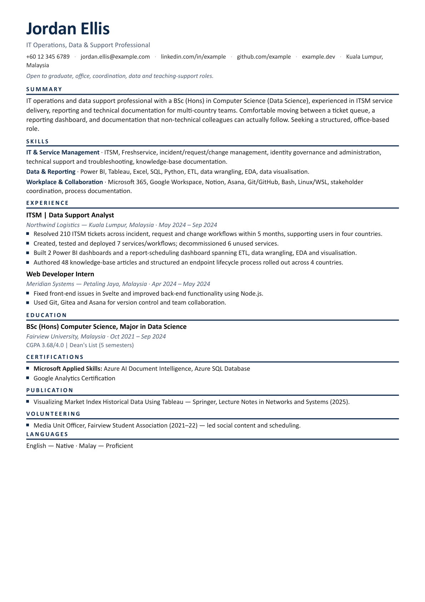
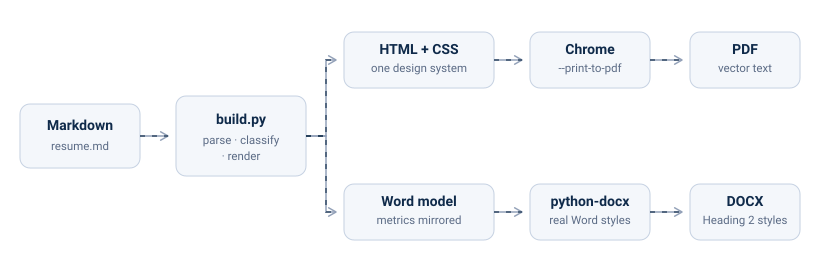
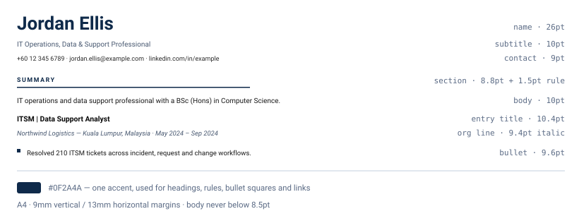

# Résumé & Cover Letter System


**One Markdown file in. An ATS-safe, single-page PDF and a matching DOCX out.**

Most résumé tooling optimises for one reader and quietly fails the other.
Pretty templates ship two-column grids and icon fonts that an applicant
tracking system cannot parse; ATS-optimised templates ship something no human
wants to look at. This system refuses the trade-off. The document is
deliberately plain where a machine is reading it and genuinely well-set where a
person is.

Below is the real output from the bundled sample — A4, one page, 2,507
characters of selectable text, 13 embedded links, one embedded TrueType font
family.

<p align="center">
  
</p>

> **This repository contains no personal data.** Everything published here is
> sample content for a fictional candidate. See [Privacy by
> default](#privacy-by-default).

---

## Why it is built this way

Two readers, two contracts:

- **The parser** wants a single column, real text, standard headings and contact
  details in the body. It gets them, and nothing in the design undermines them.
- **The recruiter** wants something that reads as considered. They get a real
  type scale, one navy accent, rules that are provably identical down the page,
  and links that are clickable but not underlined.

Everything else follows from holding both at once.

---

## How it works

<p align="center">
  
</p>

Markdown is parsed into a small set of dataclasses, section headings are
classified into canonical buckets, and the result is rendered down two separate
paths that are guaranteed to agree:

1. **PDF** — HTML plus one stylesheet, printed by headless Chrome. Vector text,
   full paged-media control, real hyperlinks.
2. **DOCX** — built with `python-docx` using real Word styles, with every metric
   mirrored from the stylesheet so both outputs paginate identically.

Chrome and Word measure text differently, so the DOCX path is the fragile one.
It is checked separately by driving Word directly — see
[Verification](#verification).

---

## Quick start

Requires **Python 3.12+**, **uv**, and **Google Chrome or Microsoft Edge**.

```bash
uv sync                        # one-time: creates .venv/
cp examples/resume.md resume.md
uv run python build.py --check # builds resume.md and runs the ATS sweep
```

That writes `Jordan_Ellis_Resume.pdf` and `.docx` at the repo root. The output
filename is derived from the H1 of your source — nothing is hardcoded.

---

## Repository layout

```
cv-resume-consolidation/
├── examples/                  ← sample content, safe to publish
│   ├── resume.md              ← copy this to ./resume.md and make it yours
│   └── cover-letter.md        ← a finished letter, as a reference
│
├── build.py                   ← Markdown → HTML → PDF (Chrome) + DOCX, + --check
├── coverletter.py             ← drafts a cover letter for a given company/role
├── verify.py                  ← output test suite: ATS, fonts, layout, links
├── check-docx.ps1             ← Word COM pagination check (Windows)
├── coverletter-template.md    ← skeleton every generated letter starts from
│
├── templates/                 ← the entire design system lives here
│   ├── resume.html
│   ├── cover.html
│   └── styles.css
│
├── docs/                      ← README graphics and the rendered sample
├── pyproject.toml  uv.lock
├── AGENTS.md                  ← editing rules, schemas, rendering constraints
└── LICENSE
```

Generated documents are gitignored — everything is reproducible from the
Markdown with one command.

---

## Using it

### Build the résumé

```bash
uv run python build.py --check
```

`--check` runs an ATS sweep: single page, selectable text, name / email / phone
present, `mailto:` and `tel:` links, LinkedIn and GitHub present, and every
expected section heading detected. Structural problems fail. A missing keyword
or a second page only warns, because both can be legitimate.

With a headshot at `photo.jpg`:

```bash
uv run python build.py --all --photo photo.jpg
```

That produces four files — with and without photo, PDF and DOCX each. The image
is centre-cropped to 3:4 and floats beside the header text.

### Tailor for a job

Never tailor the master. Copy it:

```bash
cp resume.md applications/acme-swe.md
# edit the summary, reorder skill rows, mirror the ad's real keywords
uv run python build.py applications/acme-swe.md --check --keywords "Go, Kubernetes"
```

Only mirror keywords that are actually true — you will have to defend them in
the interview. If a tailored variant spills onto a second page, **cut content**;
never shrink the type below 8.5pt.

### Write a cover letter

```bash
uv run python coverletter.py "Northwind Logistics" "ITSM Analyst"
```

This writes a Markdown letter with the date, recipient block, greeting and
sign-off already in place. Your contact line and name are pulled from
`resume.md`, so the letter always matches the résumé. Only the two body
paragraphs are left to write. Then:

```bash
uv run python build.py applications/northwind-logistics-itsm-analyst-cover-letter.md
```

### Verification

```bash
uv run python verify.py                       # every built PDF at the root
uv run python verify.py --keywords "ITSM, Power BI"
```

`verify.py` checks the PDF: A4, single page, selectable text, no stray Markdown,
the font really embedded and **not** Type3, minimum 8.5pt type, a single type
family, uniform section-rule thickness, valid link schemes, and no noise links
to technology documentation. Exit code is non-zero on failure, so it can gate a
commit.

It cannot check DOCX pagination — `python-docx` has no layout engine — so on
Windows:

```powershell
.\check-docx.ps1
```

This opens each DOCX in Word and reports the real page count. A DOCX can spill
onto a second page while the PDF still looks perfect, and nothing else catches
it.

---

## Design system

<p align="center">
  
</p>

One accent — `#0F2A4A` — used for headings, rules, bullet squares and links.
Section headings carry their weight through letter-spacing rather than bold, so
the page has rhythm without shouting. Every visual decision lives in
`templates/styles.css` and nowhere else.

---

## What an ATS can and cannot read

<p align="center">
  
</p>

The rules in the left column are enforced by the design system, not by
convention. Two of them took real work to get right and are easy to break by
accident:

- **The font must not be Type3.** Some parsers cannot extract text from
  glyph-outline fonts. Chrome will happily emit one; `verify.py` fails the build
  if it does.
- **Rules and markers are sized in whole CSS pixels.** Chrome lays out at 96dpi
  and rounds fractional units differently depending on the element's position on
  the page, so a rule specified in points renders at inconsistent weights. In
  whole pixels it snaps identically everywhere.

---

## Privacy by default

Your résumé is personal, and it does not belong in a public repository. The
paths that hold real content are gitignored by design, anchored to the root so
that `examples/` is never affected:

| Path | Contains | Tracked? |
| --- | --- | --- |
| `/resume.md` | your résumé | no |
| `/MASTER_RECORD.md` | your full career record | no |
| `/applications/` | real job applications | no |
| `/photo.jpg` | your headshot | no |
| `examples/` | sample content | **yes** |

No name, email, phone number or employer is hardcoded in the tooling — the
candidate's name is always read from the H1 of the Markdown being built. Fork
it, drop in your own `resume.md`, and nothing of the original owner travels with
it.

---

## Making it yours

1. `cp examples/resume.md resume.md` and replace the sample content.
2. Optional: `cp examples/resume.md MASTER_RECORD.md` as the shape for a longer
   private career record — the superset you cut one-page variants from.
3. Drop a headshot at `photo.jpg` if you want the photo variant.
4. `uv run python build.py --check`.

The full Markdown schema, the content rules and the rendering constraints live
in [`AGENTS.md`](AGENTS.md).

---

## License

MIT — see [`LICENSE`](LICENSE). Use it, fork it, ship your own résumé with it.
